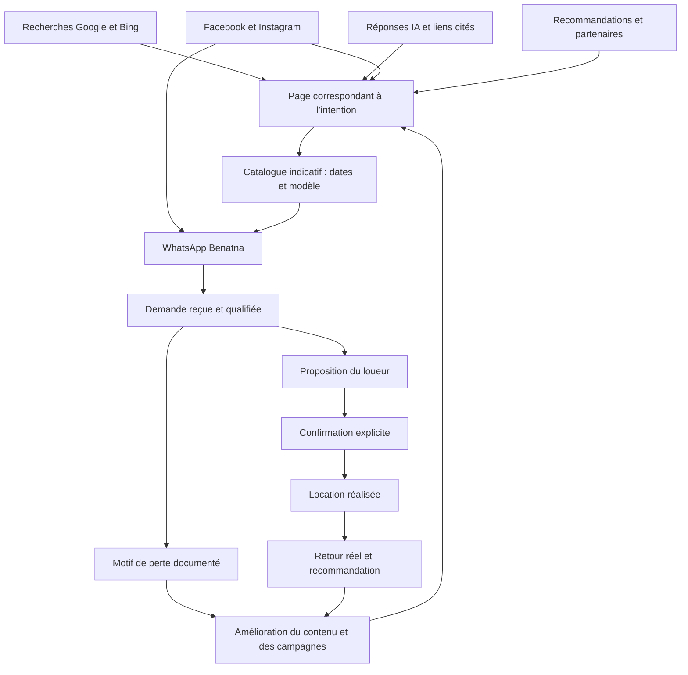

# Architecture d’acquisition Benatna

Version 1 — 15 octobre 2026. Architecture proposée, appuyée sur l’existant ; les nouvelles campagnes et la nouvelle instrumentation ne sont pas déployées. Horizon de planification : 90 jours, à ajuster selon les résultats. Aucun budget média présumé.

## Objectif et parcours

L’objectif est d’obtenir des demandes qualifiées pour une voiture à Casablanca, puis Rabat sur demande, et de savoir lesquelles aboutissent à une location. Le nombre de pages, les impressions et les clics WhatsApp ne sont pas des locations.

## Architecture des pages : une intention principale par page

| Rôle | URL existante | Intention et message | Liens suivants |
|---|---|---|---|
| Orientation de marque | `/` | Benatna, location touristique à Casablanca | Casablanca, arrivées, catalogue, FAQ |
| Pilier commercial | `/location-voiture-casablanca` | Louer une voiture pour son séjour ; prix indicatifs, minimum trois jours | Catalogue, aéroport, guide arrivées, FAQ |
| Conversion | `/louer` | Comparer les modèles classiques, sélectionner dates/point | Demande WhatsApp avec contexte |
| Besoin aéroport | `/location-voiture-aeroport-casablanca` | Arrivée Mohammed V et livraison gratuite convenue à l’avance | Guide, catalogue avec point CMN |
| Guide pratique commun | `/prise-en-charge-casablanca-rabat` | Aéroports et gares ; aucune prétendue agence ou guichet sur place | Catalogue avec point choisi, FAQ |
| Marché secondaire | `/location-voiture-rabat` | Demande depuis Casablanca, livraison gratuite, disponibilité à confirmer | Guide, catalogue Rabat |
| Réponses et confiance | `/faq` | Durée, démarche, documents et conditions à confirmer par loueur | Page commerciale et catalogue pertinents |
| Besoin de durée | `/location-longue-duree-casablanca` | Séjours personnels jusqu’à six mois calendaires | Catalogue et FAQ ; pas de cible professionnelle |
| Support éditorial | `/blog` et articles utiles existants | Préparer un séjour avec arrivée Casablanca ; réponses originales | Un pilier et un CTA contextualisés |

La distinction accueil/pilier doit rester visible : l’accueil présente la marque et oriente, le pilier répond au besoin de location. La page aéroport traite l’intention commerciale ; le guide explique les points d’arrivée. Ne pas les transformer en copies concurrentes.

Ne pas créer immédiatement une page pour chaque mot-clé, gare ou quartier. Les gares de Casablanca et Rabat se traitent d’abord dans le guide commun avec sections utiles. Les huit points déjà documentés ne constituent pas une liste exhaustive de toutes les gares : un autre point se demande au loueur. Les pages de quartiers et les nombreuses variantes existantes sont à évaluer avant toute fusion ou redirection ; aucune suppression massive n’est décidée ici. Voir inventaire-pages.csv.

## Contenu et liens internes

Pour chaque page : besoin concret, réponse courte, informations vérifiées, exemples utiles et CTA cohérent. Utiliser des liens HTML explorables entre pages complémentaires et des ancres descriptives. Le sitemap aide à découvrir les URL mais ne remplace pas ces liens [S01, S02].

Ne pas créer de pages territoriales très similaires qui ne servent qu’à ramener au catalogue : Google décrit ce risque de pages satellites [S03]. Une longueur de texte imposée ou un calendrier de publication massif ne remplace pas l’utilité [S04]. Les doublons seront traités à partir de l’intention, des liens, des données Search Console et du contenu, pas du seul nombre de mots.

Contenus prioritaires à enrichir dans les pages existantes : préparation de l’arrivée à Mohammed V ; choix citadine/berline/SUV pour un séjour ; démarche d’une demande de trois jours minimum ; documents et conditions selon loueur ; départ depuis Casa Voyageurs/Casa Port et autres points du guide. Ne pas réintroduire de frais de livraison ni d’horaires commerciaux inventés.

## SEO et recherche générative

Les fondations déjà publiées sont conservées : HTML prérendu, canoniques, sitemap, FAQ visible cohérente avec JSON-LD, accès public des robots de recherche. Google n’impose pas de fichier spécial pour ses réponses IA [S05]. OAI-SearchBot et PerplexityBot concernent la recherche ; l’entraînement des modèles est une question distincte [S06, S07].

Travail suivant : cohérence des faits dans toutes les pages, preuves réelles de service, identité/contact clairs, pages utiles citées par des partenaires pertinents. Pas d’avis fabriqués, de fausses disponibilités ou de pages de comparaison dénigrantes. Aucune promesse de classement ou de recommandation IA.

Google : cinq demandes prioritaires confirmées, traitement final à contrôler. IndexNow : 87 URL reçues en HTTP 202, clé en vérification ; pas d’indexation finale prouvée [S08]. Bing : connexion autorisée puis réussie ; sitemap soumis et confirmé en cours de traitement. Le rapport AI Performance affiche environ 1,9 k citations sur la période du 15 juillet au 14 octobre 2026, avec une moyenne affichée de deux pages citées. Ce sont des données historiques des expériences Microsoft documentées, pas des leads ni une mesure de tous les assistants [S09, S17].

## Facebook, Instagram et WhatsApp

Les observations Meta orientent trois hypothèses créatives : arrivée simple à Casablanca, choix de voiture classique pour le séjour, clarté de la démarche et de la livraison gratuite. La concurrence visible emploie aussi le prix et la messagerie ; cela ne démontre ni rentabilité ni intérêt à s’aligner sur ses prix.

Commencer par trois contenus originaux : une courte vidéo explicative verticale, un carrousel des étapes et une carte pratique des points d’arrivée. Décliner des formats lisibles plutôt qu’une multiplication de campagnes. Photos/vidéos avec droits d’usage ; préciser le caractère indicatif des modèles si nécessaire. Message central : « Préparez votre voiture pour votre séjour à Casablanca. Livraison gratuite aux points desservis, convenue à l’avance. Minimum trois jours. »

Deux parcours à comparer ultérieurement : annonce vers page aéroport puis catalogue, ou annonce vers WhatsApp avec code de campagne. Le second raccourcit le parcours mais demande une qualification manuelle et une mesure séparée. L’optimisation avancée des leads WhatsApp décrite par Meta comporte des limites géographiques, notamment dans l’UE ; vérifier ce que propose réellement le compte avant de choisir l’objectif [S10].

France francophone = première hypothèse de bassin de départ à tester, appuyée seulement par le relevé Trends disponible ; ce n’est pas une validation du meilleur coût d’acquisition. Autres bassins européens et anglais/espagnol : tests suivants selon les demandes reçues. Ne pas fragmenter un petit budget sur plusieurs pays et formats à la fois. Le lieu de diffusion d’une publicité et le lieu de livraison de la voiture sont deux choses distinctes.

Pas de campagne payante lancée, aucun budget engagé, aucun Pixel/CAPI installé dans cette intervention. Le budget maximum et le compte à utiliser seront nécessaires pour un lancement payant concret. L’autorisation passée des analytics internes n’est pas assimilée à une autorisation d’envoyer les données des visiteurs à Meta.

## Référencement local et recommandation

Vérifier le modèle réel de Benatna avant d’ouvrir ou modifier une fiche Google Business Profile : Google impose des critères d’éligibilité et exclut certaines activités de génération de contacts ou purement en ligne [S11]. Les points de livraison ne deviennent pas des agences. Ne créer ni fausses implantations en gare/aéroport ni fiches pour chaque quartier.

Préparer des collaborations pertinentes avec hébergements, guides et communautés de voyageurs. Chaque lien reçoit un code source. Toute prise de contact ou publication reste à réaliser sur instruction explicite ; aucune sollicitation n’a été envoyée. Les avis futurs doivent provenir de locations réellement réalisées.

## Mesure et décision

Voir MESURE.md : clic ≠ message reçu ≠ demande qualifiée ≠ location. Les réglages publicitaires et les nouvelles pages doivent être évalués sur les demandes qualifiées et leurs suites. La recherche IA est mesurée par des observations datées de réponses/citations et par les visites identifiables, sans conclure qu’une absence de référent signifie absence d’influence.

Ordre de travail : fiabiliser les événements et l’attribution ; consolider les pages qui répondent aux intentions ; produire trois contenus Meta ; établir une référence de demandes qualifiées ; tester un canal payant si un budget est décidé ; développer seulement ce qui apporte des demandes satisfaisables.

Le détail des références est dans sources.csv ; observations et limites dans RECHERCHE.md. Les contrôles techniques antérieurs ne constituent pas un audit complet des 87 pages.

## Mise à jour après accès Bing autorisé [S17]

Les pages les plus citées dans le relevé sont le guide carburant (environ 1,1 k citations affichées) et le guide péages (568). Le relevé comprend 18 pages, dont certaines anciennes offres désormais exclues. Conserver une information pratique exacte et lui donner des liens contextuels vers la préparation du séjour à Casablanca lorsque cela aide le lecteur. Ne pas transformer chaque article en page commerciale et ne pas recréer les offres hors zone. Le contrôle de disparition des anciennes offres dans les citations devient une tâche de suivi, sans suppression aveugle du contenu utile. Cette observation est antérieure aux corrections : aucun effet du travail récent ne peut lui être attribué.
